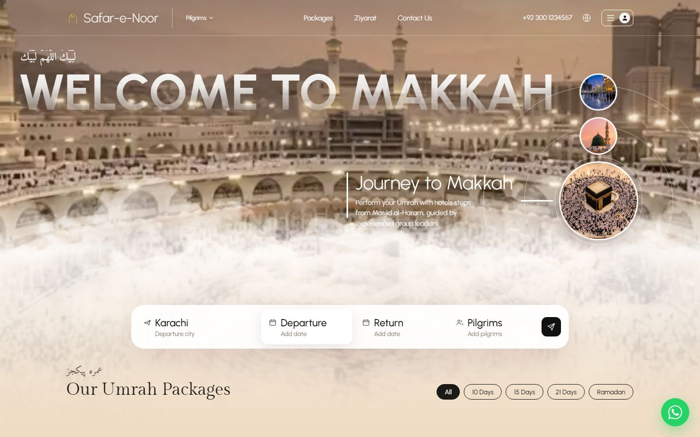
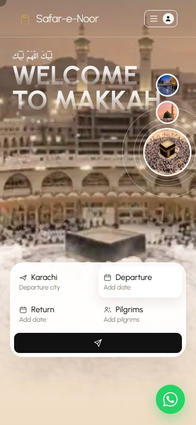
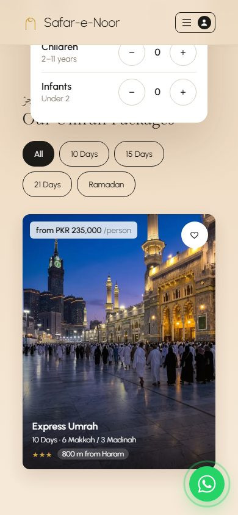

# Safar-e-Noor Travels

A demo website for a Pakistani Umrah travel agency. It presents Makkah and Madinah packages with a cinematic hero, a search bar, filterable package cards and a booking page that sends the enquiry straight to WhatsApp.

The brand, prices, hotels and phone number are all placeholders. The site is a prototype meant for client presentations.



<p>
  
  
</p>

## Features

**Hero**
- Three slides (Makkah, Madinah, the journey) that change on a timer or on click, with a soft wipe and a mist sweep.
- Slow zoom on each slide, light pointer parallax and a layer of drifting clouds.

**Search bar**
- Departure city (Karachi, Lahore, Islamabad).
- Date range calendar.
- Pilgrim counter for adults, children and infants.
- Searching scrolls to the packages and highlights the ones that match.

**Packages**
- Six packages, from a 7 day private stay to a Ramadan last-ten-nights trip.
- Filters by length (10, 15 or 21 days, or Ramadan).
- Prices in PKR, plus hotel distance from the Haram and star rating.

**Package page**
- Opens from the card with a shared image transition.
- Shows hotels, inclusions and departure dates.
- Has a live price calculator (quad, triple or double sharing, children and infants).

**WhatsApp booking**
- Builds a ready-to-send message with the package, city, date, pilgrims and estimated total.

**Ziyarat and contact**
- A Ziyarat section lists the guided visits in Makkah and Madinah.
- A contact section has WhatsApp and call buttons.

**Imagery**
- Every image is AI generated and faceless: men in ihram, women in black abaya.

## Performance

The site was built to run smoothly on mid-range phones.

**Load**
- First load is under 1 MB.
- The largest image shows in under 1 second on a simulated mid-range phone.
- No layout shift during slide changes.
- The only outside request is Google Fonts.

**Images**
- Converted to WebP and sized per use: 1920 px heroes, 760 px cards, and 1400 px images for the package page.

**Battery**
- The hero animation and the timer pause when the hero is scrolled out of view or a package page is open.

## Accessibility

- All buttons and form fields have accessible names.
- Keyboard focus is visible, and Escape closes the package page.
- Phone-sized screens get 44 px touch targets.
- With reduced motion turned on, the clouds and auto slide change stop.

## Tech

- One static `index.html` with plain HTML, CSS and JavaScript.
- No framework, no build step, no dependencies.
- Fonts: Urbanist, Gilda Display and Amiri (Arabic), from Google Fonts.

## Run locally

Any static file server works. For example:

```bash
python -m http.server 5173
```

Then open http://localhost:5173.

Opening `index.html` directly from disk also works in most browsers.

## Project structure

```
index.html   the whole site: markup, styles, data and scripts
img/         web-ready WebP images
docs/        screenshots used in this README
```

## Customising

The editable data sits near the top of the script in `index.html`:

| Constant | What it controls |
| --- | --- |
| `WA_NUMBER` | WhatsApp number in international format without `+` (currently a dummy `923001234567`) |
| `ASSETS` | Paths for every image |
| `PACKAGES` | Name, length, nights per city, hotels, star rating, sharing rates, child and infant prices, departure cities and dates |
| `SLIDES` | Hero titles, Arabic lines and captions |

## Disclaimer

Safar-e-Noor Travels is a fictional brand. All prices, hotels, dates and contact details are dummy data and do not represent a real offer.
